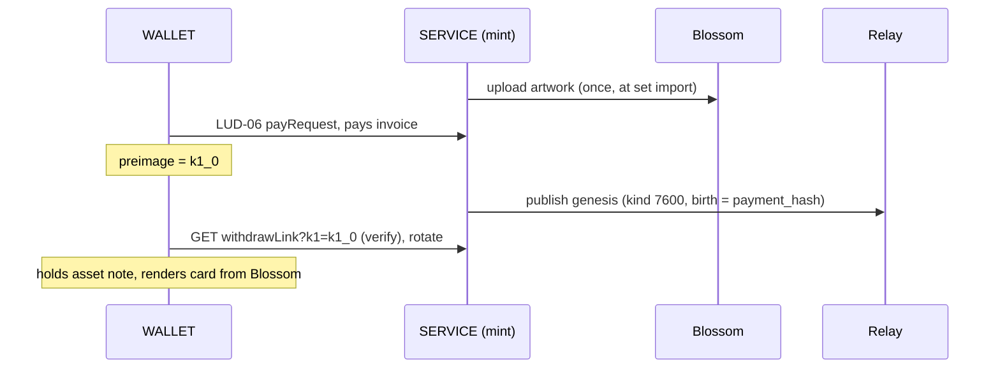

# NORD-02: LNURLcash binding

`author: FLX` `status: draft` `requires: LUD-XX LNURLcash, NORD-01`

NORD-01 defines what an asset *is*; this document defines how a mint
carries one on plain LNURLcash, and how custody moves without a QR code
ever hitting a screen. Everything here is additive: a WALLET that knows
none of it sees ordinary withdraw links and can cash them out (LUD-03);
a SERVICE that implements none of it is simply a mint without assets.

## The asset table

An asset's bearer secret changes constantly (every rotate, split input,
merge input burns one and mints another). The mint MUST track which
outstanding secret currently *is* which asset - the same bookkeeping it
already does for note values, one column wider:

```
sha256(k1_outstanding) -> (value_msat, asset_genesis_id | NULL)
```

A plain value note has `NULL` there and renders as a banknote; a note
with a genesis id is that asset. Split semantics: an asset note MUST NOT
be split (an ordinal is indivisible); the mint MUST reject `amount` on
its callback. Merge across asset notes MUST likewise be rejected. Plain
value notes split and merge as ever.

## withdrawRequest additions

```json
{
  "tag": "withdrawRequest",
  "...": "...",
  "mintPubkey": "<33-byte compressed secp256k1, hex>",
  "asset": ["<genesis event id, hex>", "<relay hint>"],
  "owner": "<npub of registered owner, hex, optional>"
}
```

- `asset` is the pointer that makes any wallet a card viewer: resolve
  the genesis event, fetch the artwork by its `x` hash from Blossom,
  verify, render. Absent on plain notes.
- `owner` is present iff the asset is in **registered mode** (below).

## Minting an asset

The LUD-XX minting flow, unchanged, plus one publication:



The genesis `birth` tag equals the paid invoice's payment hash, so the
minting wallet can verify the genesis it sees on relays is *its* asset
before it even rotates.

## Moving custody without QR codes

Three transports, all producing the NORD-01 chain events. On-screen UX
is contact-first: pick an npub, send. (Printed notes are a different
medium and out of scope here.)

### 1. Nostr handover (bearer)

The sender rotates (fresh secret only they know), then sends the note
URL to the recipient as a NIP-59 gift-wrapped rumor, kind `7604`:

```json
{
  "kind": 7604,
  "tags": [["e", "<genesis id>", "<relay>", "genesis"]],
  "content": "<the note URL, lnurlw://...?k1=...&amount=...&sig=...>"
}
```

The recipient's wallet unwraps, stores, and immediately rotates (LUD-XX
receive hygiene - the sender still knows the wrapped secret). The mint
records the bearer transfer (NORD-01 kind `7601`, mint-authored; `p`
only if the recipient disclosed an npub at rotate time via `claimer`,
below). Wrapped in NIP-59, nothing on relays links sender, recipient and
asset publicly in bearer mode.

### 2. Registered transfer

No secret travels at all. The current owner signs a NORD-01 `7601`
naming the next owner and presents it to the mint's callback; the mint
rotates internally, points `owner` at the new npub, publishes the `7602`
confirm, and the recipient's viewer sees the card arrive by watching the
chain. The nutzap pattern, for whole assets.

### 3. Link

`lnurlw://...` as text - message, mail, sticker under a scratch layer.
Still no QR on screen.

## Registered mode

Ports Cashu NUT-11's idea onto LNURLcash. When an asset is registered,
the mint MUST require, on every mutating callback for its secret, an
additional parameter:

```
callback?k1=<secret>&owner_sig=<schnorr sig, hex>
```

`owner_sig` is a BIP-340 signature by the registered `owner` npub over
`sha256("NORD/own" || k1)`. Possession of the secret alone no longer
moves the asset - a leaked or shoulder-surfed note is inert without the
owner's nostr key.

Callback operations on registered assets:

| Request | Result |
| ----------------------------------------------- | ----------------------------------------------- |
| `?k1=X&owner_sig=..` | rotate, owner unchanged |
| `?k1=X&owner_sig=..&transfer=<7601 event id>` | execute registered transfer, publish `7602` |
| `?k1=X&owner_sig=..&register=<npub>` | enter registered mode / change owner |
| `?k1=X&owner_sig=..&release=1` | leave registered mode, back to bearer |
| `?k1=X&claimer=<npub>` (bearer only) | rotate; record `p` in the mint-authored `7601` |

Entering registered mode from bearer needs only `register=` (whoever
holds the secret is the owner - that is what bearer means). A mint MUST
reject `pr` (melt) on registered assets without `owner_sig`.

## Backward compatibility

A legacy WALLET given an asset note sees a valid LUD-03 withdraw link
and can melt it - the asset discharges, the mint publishes the NORD-01
melt, the card dies. That is not a flaw; it is what bearer value means.
Registered mode exists precisely for holders who want the opposite
trade-off. A legacy SERVICE ignores every parameter above and no chain
exists - notes are just notes.

## Security considerations

- The mint MUST NOT accept a `7601` whose `prev` is not the current
  chain tip (stale or replayed transfers).
- `owner_sig` commits to the *current* secret, so a captured signature
  dies with the rotate it authorized.
- A mint SHOULD rate-limit `claimer`/`register` npub disclosure to
  mitigate chain-analysis spam of bearer assets.
- Asset notes MUST refuse split/merge server-side; a client should not
  even offer it.
